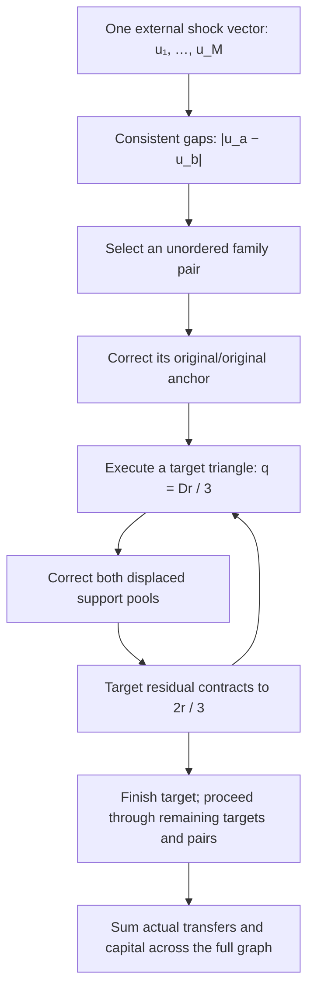

# A funded cascade across multiple underlying-asset families

## Result

Let there be \(M\ge2\) underlying families, each retaining its original asset and adding \(n\) wrappers. Put \(m=n+1\). Fund every pool in the complete graph with capital \(L\), using comparable fixed CLMM ranges and local depth \(D=\kappa L\).

Let underlying family \(a\) experience external log-price change \(u_a\). Define

\[
\varepsilon_{ab}=|u_a-u_b|,\qquad
S_M=\sum_{a<b}|u_a-u_b|.
\]

These are consistent relative-price shocks: they come from one vector of underlying prices, not independently assigned pairwise opportunities.

The explicit cascade below produces, in the local zero-burn baseline,

\[
\boxed{P=\frac{Mm(Mm-1)}2,\qquad K_{\rm pool}=LP,}
\]

\[
\boxed{V=(5m^2-4)\kappa L S_M,\qquad
T=4n(n+1)\kappa L S_M.}
\]

Here \(V\) is aggregate pool turnover and \(T\) is actual taxable wrapped-transfer turnover, counted once per transfer. Volumes and burn values are measured in one common numeraire using the local reference prices. Consequently, for a sufficiently small proportional burn \(f\),

\[
\boxed{B=4f\kappa L n(n+1)S_M+O(f^2).}
\]

For the stipulated \(f=10^{-6}\), this is a first-order formula, not a numerical error guarantee. It establishes a genuine multifamily cascade rather than presuming revenue per edge.

## 1. Explicit complete-graph execution

Write family \(a\) as \(X_{a,0},X_{a,1},\ldots,X_{a,n}\), where index zero denotes the original. All \(P\) pools are funded, including same-family pools and all cross-family pools.

For each unordered family pair \(a,b\), process the following routes, reversing trade directions when the shock has the opposite sign:

1. Correct original/original pool \(X_{a,0}X_{b,0}\) externally.
2. Process targets \(X_{a,i}X_{b,0}\) through the triangle containing \(X_{a,0}\).
3. Process targets \(X_{a,0}X_{b,j}\) through the triangle containing \(X_{b,0}\).
4. Process targets \(X_{a,i}X_{b,j}\) through the triangle containing \(X_{a,0}\). Its supports are same-family spoke \(X_{a,0}X_{a,i}\) and already-corrected cross-family pool \(X_{a,0}X_{b,j}\).

After every triangle trade, externally correct both support pools before repeating that target.

For equal local depths, a target residual \(r_k\) gives triangular profit

\[
\Pi(q)=r_kq-\frac{3q^2}{2D},
\qquad q_k=\frac{Dr_k}{3}.
\]

The triangle displaces both supports. Restoring them leaves

\[
r_{k+1}=\frac23r_k,
\qquad
\sum_{k\ge0}q_k=D\varepsilon_{ab}.
\]

Thus each target contributes three triangle legs and two corrective legs, totaling \(5D\varepsilon_{ab}\). The original/original anchor contributes \(D\varepsilon_{ab}\), giving

\[
V_{ab}=\left[1+5(m^2-1)\right]D\varepsilon_{ab}
=(5m^2-4)D\varepsilon_{ab}.
\]

**Why summing across families is valid:** cross-family target pools for different pairs are distinct. Same-family spokes may be shared, but are restored after each use. Inductively, every new target starts untouched and every supporting pool starts corrected. Unused same-family edges remain fair. Shared supports therefore create real repeated turnover without being treated as independent or omitted from funding.

Other profitable routes can coexist; this is a feasible, individually profitable execution schedule, not a proof that a globally profit-maximizing arbitrageur or competitive network necessarily selects it.

## 2. Transfer-burn accounting

Assume originals are untaxed, mint/redemption legs are exempt, and triangles settle directly pool-to-pool. Count a transfer shared by two adjacent pools only once.

For one family pair:

- Its \(2n\) original/wrapper targets each generate \(2D\varepsilon_{ab}\) taxable volume: one wrapped triangle transfer and one wrapped support correction.
- Its \(n^2\) wrapper/wrapper targets each generate \(4D\varepsilon_{ab}\): two wrapped triangle transfers and two wrapped support corrections.

Therefore

\[
T_{ab}=\left[4n+4n^2\right]D\varepsilon_{ab},
\]

which sums to the stated result. Direct correction would produce half this taxable volume. The cascade **doubles leading-order gross burns** in this schedule, while reusing existing pools.

The small-burn extension assumes stable reserve/share-price feedback, bounded depth-to-supply sensitivities and no range exhaustion. Burn-driven NAV changes can create additional routes; their corrections are not solved exactly here. Router intermediaries, nonexempt redemption, fixed gas costs or binding order limits change execution and coefficients.

## 3. A positive, bounded family-count benefit

Define the mean pairwise relative shock

\[
\mu_M=\frac{2S_M}{M(M-1)}.
\]

The leading gross burn yield on pool capital is

\[
Y_M=\frac{B}{K_{\rm pool}}
=4f\kappa n\mu_M\frac{M-1}{M(n+1)-1}.
\]

Holding \(\mu_M=\mu>0\) fixed gives a genuine increasing-yield result:

\[
\boxed{Y_{M+1}-Y_M
=\frac{4f\kappa n^2\mu}
{[M(n+1)-1][(M+1)(n+1)-1]}>0,}
\]

\[
\boxed{Y_M\longrightarrow\frac{4f\kappa n\mu}{n+1}.}
\]

This comparison is realizable with consistent node shocks. Evenly space the \(u_a\) over width

\[
w_M=\frac{3\mu(M-1)}{M+1}<3\mu.
\]

Then their mean pairwise gap is exactly \(\mu\); an unbounded shock range is unnecessary. These are comparable price-vector scenarios, not a claim that all old family shocks remain unchanged when each new family is appended.

### Increase both family count and per-pool liquidity

Set \(n=2\), \(L_0\) as baseline capital per pool, and \(B_0=f\kappa L_0\mu\). The table shows first-order gross results at fixed mean pairwise shock.

| Families \(M\) | Pools \(P\) | \(L/L_0\) | Capital / \(L_0\) | Burn / \(B_0\) | Yield / \(f\kappa\mu\) |
|---:|---:|---:|---:|---:|---:|
| 2 | 15 | 1 | 15 | 24 | 1.600 |
| 3 | 36 | 2 | 72 | 144 | 2.000 |
| 4 | 66 | 4 | 264 | 576 | 2.182 |
| 8 | 276 | 8 | 2,208 | 5,376 | 2.435 |
| 16 | 1,128 | 16 | 18,048 | 46,080 | 2.553 |

Absolute burns increase with both dimensions, and gross yield increases toward \(8f\kappa\mu/3\). The liquidity multiplier itself cancels from yield; the graph-dependent factor supplies the increase.

## 4. What changes when total price spread is fixed instead

If the shocks are evenly spaced over a fixed width \(\varepsilon\), then

\[
S_M=\varepsilon\frac{M(M+1)}6,
\qquad
Y_M=\frac{4f\kappa n\varepsilon(M+1)}{3[M(n+1)-1]}.
\]

Here gross yield **decreases** with family count: the average pairwise shock declines toward \(\varepsilon/3\). Using the same liquidity/pool-count rows, with \(\widetilde B_0=f\kappa L_0\varepsilon\), gives:

| Families | Burn / \(\widetilde B_0\) | Yield / \(f\kappa\varepsilon\) |
|---:|---:|---:|
| 2 | 24 | 1.600 |
| 3 | 96 | 1.333 |
| 4 | 320 | 1.212 |
| 8 | 2,304 | 1.043 |
| 16 | 17,408 | 0.965 |

Both comparisons keep shocks consistent. They answer different questions: fixed average relative movement versus fixed outer price spread. Family count alone does not specify which applies.

For a literal addition preserving old shocks, a new family with shock \(v\) adds

\[
G(v)=\sum_{a=1}^M|v-u_a|.
\]

Its leading gross yield improves precisely when

\[
\boxed{G(v)>S_M\frac{2mM+m-1}{M(mM-1)}.}
\]

This is directly evaluable from the external shock vector and funded graph. Adding a family far from existing shocks can satisfy it; adding one near their median may not.

## 5. Unequal family sizes and economic interpretation

If family \(a\) has \(m_a\) total assets, including its original, let \(N=\sum_a m_a\). Then

\[
P=\frac{N(N-1)}2,
\]

\[
V=D\sum_{a<b}(5m_am_b-4)|u_a-u_b|,
\]

\[
\boxed{T=D\sum_{a<b}(4m_am_b-2m_a-2m_b)|u_a-u_b|.}
\]

The same restored-support proof applies.

Scaling all pool positions, backing reserves, wrapper supplies and scalable balances together multiplies burns, capital and wealth equally; it does not by itself change ROI. Fixed-size costs can introduce separate activation thresholds.

**Conclusion:** multiple underlying families create quantitatively more cascade opportunities. With fixed mean pairwise movement, the solved complete-graph model also gives increasing but bounded **gross burn yield on pool capital**. This is not yet consolidated net profit: separately funded backing, external price gains/losses, outside arbitrage extraction, ownership and the full shock/return cycle must enter the net ledger. The formula proves the cascade mechanism and its scaling, without treating redistributed claims as newly created external assets.
